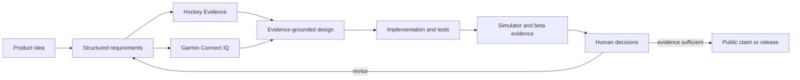
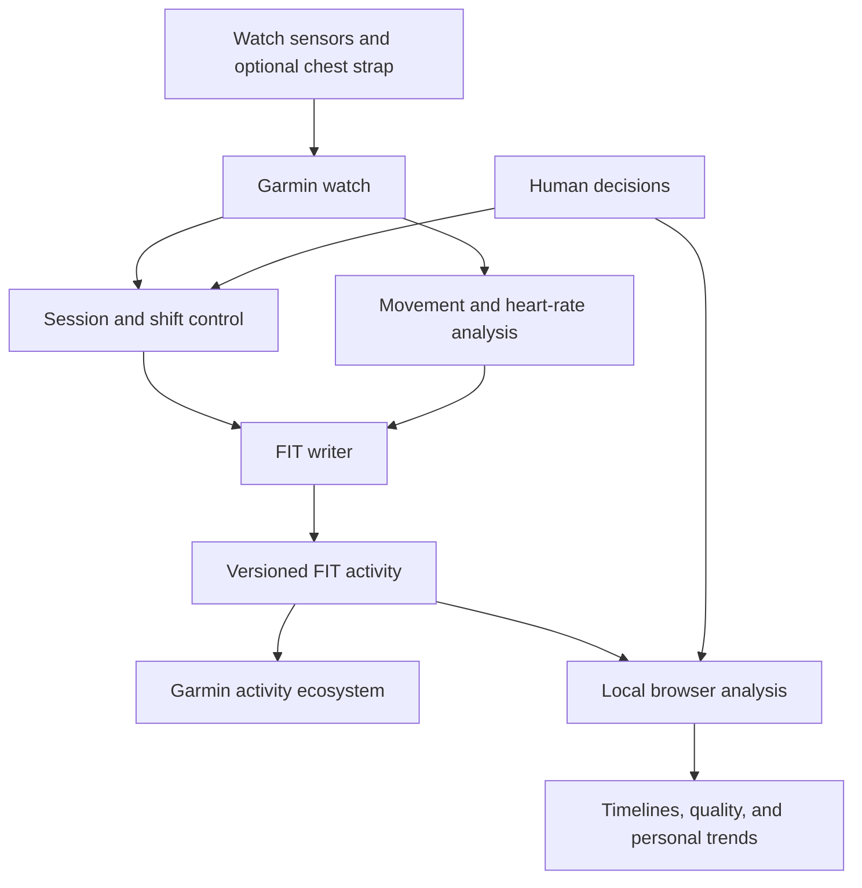

# Architecture

This document presents the approved ShiftSense Hockey architecture and the AI-assisted decision system behind it. The application is still in beta, so module boundaries describe the technical design; they are not a claim that every planned capability has completed validation.

## AI skills and human decisions

The workflow uses specialized skills to constrain decisions before implementation. Human judgment remains the release authority.

The loop matters more than the arrow from prompt to code. Evidence can narrow a metric, the platform can rule out an interface, and beta feedback can send the product back to requirements.

## System boundary

ShiftSense Hockey separates the time-critical watch experience from deeper analysis. The core recording path does not require a phone, account, or server.

## Watch responsibilities

The watch-side design divides work into focused units:

| Unit | Responsibility |
|---|---|
| Session controller | Own the activity lifecycle, start, pause, recovery, stop, and save. |
| Sensor adapter | Normalize heart rate, beat intervals, accelerometer, gyroscope, and optional position data. |
| Capability profile | Detect available APIs, sensors, resources, display shape, touch, and buttons. |
| Ice and inline models | Keep sport-specific parameters and calibration separate. |
| Shift classifier | Maintain conservative bench, transition, shift, stoppage, and uncertain states. |
| Movement analyzer | Derive movement energy, pushes, bursts, glide patterns, and experimental events. |
| Heart-rate analyzer | Calculate zones, response, and recovery when data quality permits. |
| Distance providers | Keep optional GPS distance distinct from inertial estimates. |
| Local calibrator | Update personal parameters only from suitable reference segments. |
| Load analyzer | Produce transparent component scores without replacing Garmin Training Effect. |
| FIT writer | Preserve standard activity data and versioned developer fields. |
| Watch UI | Keep live information minimal and make manual markers immediately accessible. |

Small interfaces allow sensor logic, classification, storage, and presentation to evolve independently as beta evidence changes.

## Data flow and precedence

Sensor samples enter adapters before they reach analysis. Capability checks determine which inputs are available. Manual shift markers override automatic classification around the marked transition. Every segment carries time, type, source, and confidence.

Derived values flow to the FIT writer only with a schema and model version. Missing or poor-quality inputs produce unavailable metrics or quality warnings—not invented interpolation.

## Local browser analysis

The companion analysis layer is designed to import FIT files locally, validate standard and developer fields, and display session summaries, shift timelines, recovery, movement, and data quality. Corrections to detected shift boundaries remain distinct from the original activity record.

No cloud account or backend is required by the version-one design. A later synchronization layer can be added behind a separate interface without making it a prerequisite for core recording.

## Capability-based support

Device names alone are not sufficient architecture. Features depend on API level, sensors, sampling, memory, display, and input methods. A reduced mode may record time, heart rate, zones, calories, and manual shifts on constrained devices while withholding unsupported movement analysis.

Public compatibility claims will follow simulator and class-level hardware evidence. The design's candidate device families are not yet a published support list.

## Privacy and failure behavior

- GPS is optional and never required for indoor recording.
- Sensor loss does not discard the entire session; dependent metrics become unavailable.
- Chest-strap fallback is recorded as a source change.
- Calibration updates apply only after a successfully saved activity.
- The durable FIT activity takes priority when resources become constrained.
- Personal analysis can remain on the user's devices.

These boundaries turn privacy and recoverability into architecture rather than policy added after implementation.
