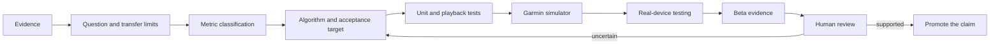

# Validation and Claim Discipline

AI can accelerate implementation, but it cannot upgrade an estimate into a measurement. ShiftSense Hockey uses an evidence pipeline that makes every public claim earn its wording.

## Evidence-to-claim pipeline

## Metric classification

| Class | Meaning | Example |
|---|---|---|
| Measured | Directly sampled or timed by the system | elapsed time, sensor coverage |
| Device-provided | Calculated by Garmin and reported as such | calories or Training Effect when available |
| Derived | Calculated from defined inputs and transparent rules | work-to-rest ratio, time in configured zones |
| Estimated | Model-based value with material uncertainty | inertial distance or push count |
| Experimental | Exploratory signal that needs more validation | possible impacts or technique stability under fatigue |

The class travels with the metric. A successful implementation does not by itself change the class.

## Validation layers

### Deterministic tests

Unit tests cover isolated calculations and state transitions. Playback tests apply recorded or synthetic sensor traces to classification and analysis logic. These tests are repeatable and good at detecting regressions, but they cannot prove that a model represents real hockey accurately.

### Garmin simulator

Simulator testing checks layouts, input paths, lifecycle behavior, permissions, device resources, and failure scenarios across device profiles. It is necessary for compatibility work but cannot reproduce every sensor or equipment condition.

### Real-device sessions

Hardware sessions check recording stability, sensors, chest-strap behavior, controls, vibration, and FIT output under actual use. Where possible, manual timing or video provides a shift reference and a Polar H10 provides a higher-quality heart-rate reference.

### Beta testing

Beta testing adds different users, sessions, devices, and behavior. It is where usability assumptions and rare failures become visible. Beta feedback can justify a fix or a new hypothesis; it does not automatically establish scientific validity.

## Data-quality contract

Each activity is designed to report the context needed to interpret its metrics:

- heart-rate source and source changes;
- valid-data coverage and gaps;
- confident and uncertain shift time;
- GPS availability and quality when enabled;
- calibration maturity;
- model and FIT schema versions.

Insufficient inputs should produce “not available,” not a precise-looking substitute.

## Claim promotion

A feature may be implemented while its validation remains pending. Public wording becomes stronger only when evidence exists for the actual population, hardware, algorithm version, and test condition being described.

This repository currently makes no numerical accuracy claim and publishes no definitive device-support matrix. The documented Venu 2 Plus and Garmin Connect checks establish that the tested beta build operated through recording, manual shifts, saving, summaries, and custom activity fields; they do not establish automatic-shift, push-count, or distance accuracy.

## Scientific and medical boundary

ShiftSense Hockey is a training and analysis project, not a medical device. It does not diagnose injury or concussion. Experimental event signals must not be described as definitive collision counts or medical indicators.
